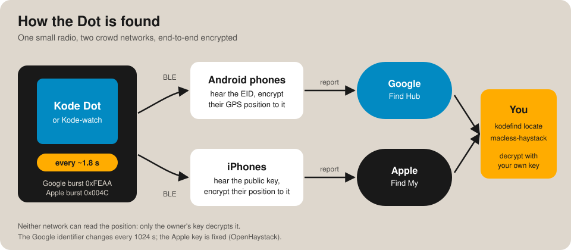
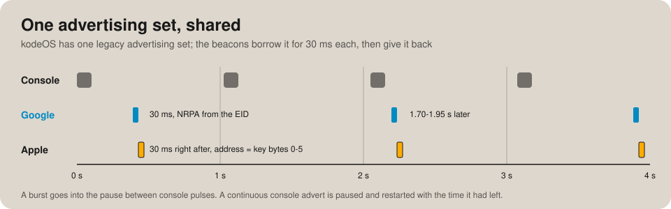
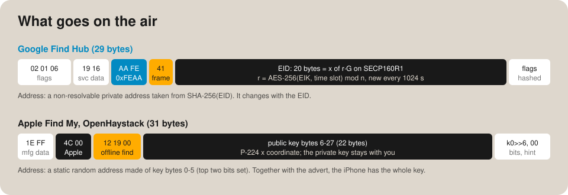

# kode-findhub

**Put your Kode Dot on Google's Find Hub network and Apple's Find My
network**, built into kodeOS. It runs on the Kode-watch too.



The Kode Dot is small and easy to lose. With this patch, kodeOS sends a
**Find Hub Network** (FHN) beacon between its own Bluetooth adverts. Any
Android phone nearby that has Find Hub on reports the Dot's position to
your Google account, end-to-end encrypted. Nobody else can read it,
including Google. You see the position with the `kodefind` tool.

> Unofficial. This project is not made, approved or supported by Kode or by
> Google. It does not use the Kode name for a product. "Kode Dot" only says
> which device it runs on. The Find Hub side uses the reverse-engineered
> API of [GoogleFindMyTools](https://github.com/leonboe1/GoogleFindMyTools),
> because Google certifies Find Hub accessories only for manufacturers.

* **Status:** the beacon maths are tested against Google's algorithm. The
  kodeOS build passes, and a built image is in [dist/](dist/). **Not yet tested on a real Dot or with real Android
  phones.** See [Status](#status).
* **Apple Find My:** the OpenHaystack way, next to Google. Locations come
  through macless-haystack or OpenHaystack, not the Find My app. See
  [docs/find-my.md](docs/find-my.md).
* **Channel Sounding (Bluetooth 6.0):** design only. It needs an RF module
  with a CS-capable chip. See [docs/channel-sounding.md](docs/channel-sounding.md).

---

## Contents

1. [How it works](#how-it-works)
2. [What you need](#what-you-need)
3. [Build kodeOS with Find Hub](#build-kodeos-with-find-hub)
4. [Register the Dot and set the key](#register-the-dot-and-set-the-key)
5. [Find the Dot](#find-the-dot)
6. [Console commands](#console-commands)
7. [Static mode (the proven way)](#static-mode-the-proven-way)
8. [Privacy and anti-stalking](#privacy-and-anti-stalking)
9. [Limits](#limits)
10. [Status](#status)
11. [Repository layout](#repository-layout)
12. [Licence](#licence)

---

## How it works

```
  Kode Dot (kodeOS)                    Android phone nearby              You
  ----------------                     --------------------              ---
  EIK (32-byte secret, in NVS)
  every 1024 s: EID = f(EIK, time)
  every ~1.8 s: advert 0xFEAA  ----->  hears EID, encrypts its own
               (30 ms burst)           GPS position to the EID
                                       (ECIES on SECP160R1)
                                           |
                                           v
                                    Google Find Hub servers  <-----  kodefind locate
                                    (match EID, store blob)          (decrypt with EIK)
```

* **EID (ephemeral identifier).** This is the x coordinate of `r·G` on
  SECP160R1. `r = AES-256-ECB(EIK, block(time)) mod n`. It changes every
  1024 s, so people around you cannot follow the Dot.
* **Upload.** Google only stores reports for EIDs it expects. `kodefind`
  uploads the next 4 days of EIDs for your tracker. Run `kodefind locate` at
  least every 4 days, or reports stop.
* **Beacon clock.** The clock is seconds since the registration
  (`pair_date`). The Dot takes it from its wall clock. With no wall clock
  (the battery was cut), it continues from a checkpoint it writes to flash
  every 6 hours.
* **Sharing the radio.** The Dot's NimBLE host has one legacy advertising
  set, and the console's advert uses it. The beacon borrows it for one
  30 ms non-connectable burst from its own random address (an NRPA derived
  from the EID), then gives it back. A continuous console advert is paused
  and restarted with the time it had left. A pulsed one (kodeOS's resting
  advert) is not touched: the burst goes into the pause. The spec asks for
  at least one advert every 2 s. The beacon sends one every 1.70-1.95 s.





The whole algorithm is in [components/kfind](components/kfind) (pure C,
host-tested). The scheduler is in
[os/sdk/kdrv_ble_fhn.inc](os/sdk/kdrv_ble_fhn.inc).

## What you need

* A Kode Dot, and a computer to build kodeOS on (ESP-IDF v6.1).
* A Google account with an **Android phone** signed in. In Find Hub,
  enable *Find your offline devices* ("With network in all areas" works
  best). The phone is needed once, so that your account has its
  end-to-end-encryption keys.
* Python 3.10+, Google Chrome (for the first sign-in of GoogleFindMyTools),
  and a clone of GoogleFindMyTools:

```bash
git clone https://github.com/leonboe1/GoogleFindMyTools.git
```

```bash
pip install -r GoogleFindMyTools/requirements.txt pyserial
```

## Build kodeOS with Find Hub

```bash
git clone --recursive https://github.com/kodediy/KodeOS.git
```

```bash
./os/apply.sh KodeOS
```

```bash
cd KodeOS && . $HOME/esp/esp-idf/export.sh && idf.py build && idf.py -p PORT flash
```

`apply.sh` copies the beacon into `sdk/components/kdrv/radio/` and applies
two patches: [os/kode-sdk.patch](os/kode-sdk.patch) to the SDK submodule and
[os/kodeos.patch](os/kodeos.patch) to kodeOS. The patches are made against
**kodeOS 0.1.5 / kode-sdk v0.1.5** (`7ebfdd8` / `d775f3d`). On a newer
kodeOS they may need a small manual merge. The feature is behind
`CONFIG_KODEOS_FINDHUB`, which is on by default in kodeOS.

Nothing goes on the air until you set a key.

## Register the Dot and set the key

Connect the Dot with USB-C. Then run, once:

```bash
python3 tools/kodefind/kodefind.py --gfmt GoogleFindMyTools register --name "Kode Dot" --port /dev/ttyACM0
```

1. On the first run, Chrome opens for the Google sign-in. The tokens stay in
   `GoogleFindMyTools/Auth/secrets.json`.
2. A new 32-byte identity key (EIK) is made and registered as a tracker
   in your account. The key is saved in `~/.kodefind/Kode_Dot.json`
   (mode 600). **Keep a backup: without the key you cannot decrypt the
   locations.**
3. Over USB, the Dot gets
   `findhub_set eik="…" pair_date=…`. The key is refused on BLE or MQTT.
   Then `findhub_info` shows the beacon running.

Without `--port`, the tool prints the line for you to type in a serial
terminal.

## Find the Dot

```bash
python3 tools/kodefind/kodefind.py --gfmt GoogleFindMyTools locate
```

Pick the tracker. The tool first uploads the next 4 days of identifiers,
then asks Google for the last reports. It decrypts each report by trying
the rotation slots of the last 9 days, and prints the latitude, longitude
and a Google Maps link. Run it at least every 4 days, for example from cron.

Find Hub collects reports from several phones before it shows a place, and
only when phones pass by. Expect minutes to hours in a city, and much longer
in quiet places.

## Console commands

On the USB console (`kcli`, or any serial terminal at 115200):

| Command | What it does |
|---|---|
| `findhub_set eik="<64 hex>" pair_date=<unix s> [utp=on\|off]` | Rotating mode (what `kodefind register` writes). Cable only. |
| `findhub_set key="<40 hex>" [utp=on\|off]` | Static mode: one fixed EID. Cable only. |
| `findhub_off` | Forget the key and stop the beacon. |
| `findmy_set key="<56 hex>"` | Apple Find My: the OpenHaystack advertisement key (`tools/haystack/genkey.py`). Cable only. |
| `findmy_off` | Stop the Apple advert. |
| `findhub_info` | `>|findhub mode=rotating utp=on host=up clock=wall beacon_t=… slot=… next_s=… eid=… addr=… batt=normal sent=… skipped=…` |

`utp=on` (the default) sends frame type `0x41`, "unwanted tracking
protection". This is what the working GoogleFindMyTools firmware sends.
`utp=off` sends `0x40`.

In the settings, **More → Bluetooth** shows ", Find Hub on" while a key is
set.

## Static mode (the proven way)

GoogleFindMyTools' own ESP32 firmware sends one fixed EID. This is known to
work with Google's servers. If rotating mode gives no locations, try this:

1. Run `python3 main.py` in GoogleFindMyTools, press `r`, and copy the
   40-hex "Advertisement Key".
2. Run `python3 tools/kodefind/kodefind.py static --key <key> --port /dev/ttyACM0`.
3. Find it with GoogleFindMyTools' own `main.py`.

The cost: the same identifier forever, so anybody with a BLE scanner can
recognise your Dot.

## Privacy and anti-stalking

* The EIK is a secret. It is stored in the Dot's NVS (not encrypted unless
  your kodeOS build enables NVS encryption) and in `~/.kodefind/`. Anyone
  with the EIK can follow the Dot.
* Rotating mode changes the EID and the address every ~17 minutes
  (1024 s plus 1-204 s of jitter).
* In UTP mode (`0x41`), Android may warn people near the Dot that an
  unknown tracker travels with them. This is the safeguard of Find Hub:
  do not turn it off to follow someone. **Only track your own Dot.**

## Limits

* **The beacon runs only while kodeOS runs and its BLE host is up.**
  * Starting an app restarts the board into that app, so the beacon is
    silent while an app runs. An app built with this SDK and
    `CONFIG_KODEOS_BLE=y` beacons too.
  * The beacon keeps going when you switch Bluetooth off in the settings.
    That switch only quiets the console; `findhub_off` stops the beacon.
    If Bluetooth was off at boot, the host does not start and there is no
    beacon.
  * With no USB, the charger can cut the battery completely ("off"). Then
    nothing sends.
* No Fast Pair, so it does not show up in the Find Hub app as an Android
  accessory, and you cannot ring it from the app. Locations come through
  `kodefind` only.
* No "Get identifier" and no NFC lookup for people who find the Dot.
* Battery level in the hashed flags: normal at 25 % or more, low below 25 %,
  critical below 10 %. This assumes that kodeOS reports the battery to the
  BLE driver (`kdrv_ble_battery_set`).
* The bit layout of the hashed flags (battery = bits 5-6 = `0x60`, UTP =
  bit 7 = `0x80`, XOR with the last byte of SHA-256(r)) is our reading of
  the spec. Google's servers are not known to check it.

## Status

| Part | State |
|---|---|
| EID, hashed flags, advert, NRPA (C) | 59/59 host tests. The EID matches GoogleFindMyTools' `generate_eid` byte for byte. AES-256 and SHA-256 are checked against FIPS vectors. |
| kodeOS build with the patch | passes (ESP-IDF v6.1, `-Werror`). Image in `dist/`. See [docs/build-log.md](docs/build-log.md) |
| On a real Dot (radio timing, console coexistence) | **not tested** |
| Rotating EIDs accepted by Google's servers | **not tested.** The upload uses the same request as GoogleFindMyTools, with real rotating EIDs. |
| `kodefind` against Google | **not tested** (needs your account) |
| Apple advert (OpenHaystack) | byte layout tested against OpenHaystack's ESP32 firmware. Runs on the Kode-watch (0.41.0) next to Google's, with a throwaway key. Not yet located through Apple. |
| Kode-watch (0.40.0 / 0.41.0) | on hardware: the EID matches the reference byte for byte, both bursts go out, the watch stays stable |
| Channel Sounding | design only |

## Repository layout

```
components/kfind/      the beacon maths, pure C (+ micro-ecc, BSD-2)
os/apply.sh            puts it all into a KodeOS checkout
os/kode-sdk.patch      SDK changes: kdrv_ble hooks, Kconfig, CMake, verbs
os/kodeos.patch        kodeOS change: Find Hub in More → Bluetooth
os/sdk/                new SDK files: kdrv_ble_fhn.{h,inc}, findhub_verbs.c
tools/kodefind/        register / provision / locate (on GoogleFindMyTools)
tools/haystack/        genkey.py: an OpenHaystack key pair for Apple Find My
tools/reference/       Python reference of the maths, makes the test vectors
tests/host/            `make -C tests/host`
tests/tools/           offline test of kodefind against GoogleFindMyTools' crypto
docs/                  channel sounding, build log, Nederlands
dist/                  kodeOS 0.1.5 + Find Hub, built (flash at 0x20000)
```

## Licence

GPL-3.0-or-later, like kodeOS and GoogleFindMyTools. The Apple advert's
layout is reimplemented from OpenHaystack's documentation and firmware
(AGPL-3.0); no OpenHaystack code is copied. micro-ecc
(`components/kfind/third_party/micro-ecc`) is BSD-2-Clause.
