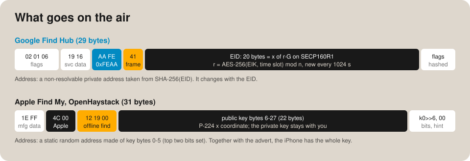

# Apple Find My (OpenHaystack)

The Dot, and the Kode-watch, can also send Apple's **offline-finding
advert**, the one AirTags use. iPhones nearby then report the Dot's position
to Apple, encrypted to a public key that you made. This is the
[OpenHaystack](https://github.com/seemoo-lab/openhaystack) method, from TU
Darmstadt's Secure Mobile Networking Lab.

> **It does not appear in the Find My app.** Apple's "Add Other Item" only
> takes accessories certified in Apple's MFi Find My programme. You read the
> positions with **macless-haystack** (any computer with Docker) or
> **OpenHaystack** (a Mac). Both are third-party tools that use your Apple ID.

## 1. Make a key

```bash
python3 tools/haystack/genkey.py --name "Kode Dot" --port /dev/cu.usbmodem101
```

For the Kode-watch, add `--watch`. Without `--port`, the tool prints the line
to type on the USB console.

* `~/.kodefind/haystack/Kode_Dot.keys` holds the private key, the
  advertisement (public) key and the hashed key. **Back it up.** Without the
  private key the reports cannot be read.
* Only the 28-byte **public** key goes to the device. It sends that key in
  its advert anyway.

On the Dot the line is `findmy_set key="<56 hex>"`. On the watch it is
`findmy key <56 hex>`, over USB, or through the hub:
`{"ctl":"findmy","arg":"key <56 hex>"}`.

## 2. Read the positions

**macless-haystack** (Linux, Windows or Mac; Apple ID with two-factor
authentication):

1. Follow its README: https://github.com/dchristl/macless-haystack . It runs
   an anisette server and an endpoint in Docker, and serves a web page.
2. Import `~/.kodefind/haystack/Kode_Dot.json` in the web page, or copy the
   `.keys` file where its README says.
3. The page shows the Dot on a map from the last reports.

**OpenHaystack** (Mac, with its Mail plug-in): import the key from the
`.keys` file. OpenHaystack's own "Deploy" step is not needed, because the Dot
already sends the advert.

## What is sent



* The advert is manufacturer data `4C 00` (Apple), type `12`, length `19`,
  then status `00`, public-key bytes 6 to 27, the two top bits of key byte 0,
  and hint `00`. This is 31 bytes, a whole legacy packet.
* The address is static random: key byte 0 with its top two bits set, then
  key bytes 1 to 5.
* The Apple burst goes out right after Google's, every 1.70 to 1.95 s, for
  30 ms. With Google off, it goes alone.

## Limits and privacy

* **One fixed key.** The address and the advert never change, so anybody
  with a BLE scanner can recognise the Dot. OpenHaystack works this way. Key
  rotation would need a list of keys on both sides.
* iPhones have anti-stalking checks. An iPhone that travels with the Dot for
  a while may warn its owner about an unknown accessory. Only track your own
  device.
* Using Apple's network this way is not approved by Apple. It may stop
  working whenever Apple changes its servers.
* Like Google's beacon, it only runs while kodeOS (or the watch OS) runs and
  its BLE host is up.
